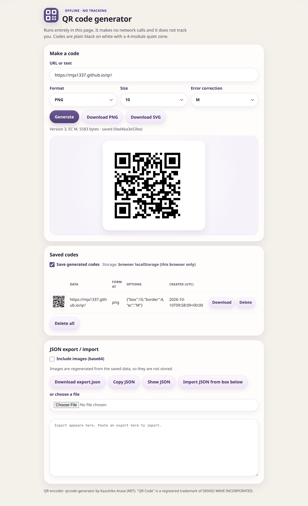
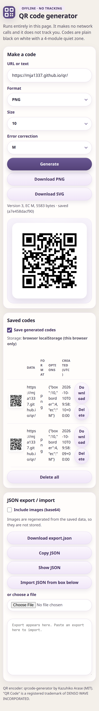

# QR

**Offline QR codes. No tracking.**

A QR code generator that stays on your machine. The web page makes no network calls: encoding happens in the browser, and saved codes stay in that browser. The Python server is the same idea with a local SQLite file. There is no account, no analytics, and no remote database.

**Live demo:** <https://mja1337.github.io/qr/>

GitHub Pages has to be enabled before that link serves the page: repository **Settings → Pages → Deploy from a branch**, branch `main`, folder **`/ (root)`**. The site is `index.html` at the root of this repository. `.nojekyll` is included so Pages serves the files as they are.





## Features

**Web page** (`index.html`)

- PNG and SVG download. Modules are plain black on white, with a 4-module quiet zone.
- Module size and error correction (L, M, Q, H).
- A save toggle. When saving is on, codes go to `window.storage` if the page's host provides it, otherwise `localStorage`, otherwise memory for this tab only.
- JSON export and import. Export can include images as base64. Images are drawn again from the saved text, so the stored record is the text and the options.
- One self-contained file. No CDN and no webfonts.

**Python server** (`server/`)

- A browser form, a small HTTP API, and a CLI: `serve`, `gen`, and `export`.
- Local SQLite is on by default. `QR_DB_ENABLED=false` turns it off: SQLite is never imported, no database file is created, and nothing is stored.
- `GET /export.json` and `GET /export.json?images=1`.
- A Dockerfile and a Procfile.

## Use the web page

Open `index.html` in a browser. A double-click is enough. It works from a `file://` address with no local server and no network access.

After Pages is enabled, the same page is at <https://mja1337.github.io/qr/>.

Type a URL or any text, choose format, size, and error correction, then **Generate**. **Download PNG** and **Download SVG** use the last code you generated. Leave **Save generated codes** on to keep a list in this browser, or turn it off and nothing is read or written. **Download export.json**, **Copy JSON**, and **Show JSON** export that list. **Include images (base64)** adds the picture data. Paste JSON into the box, or choose a file, then **Import JSON from box below**. Import merges by id and skips duplicates.

A saved row stores the text and options (format, module size, quiet zone, error correction), plus version, time, and byte size. The picture is drawn again when you export or display it.

## Run the Python server

From `server/`:

```bash
python3 -m venv .venv
.venv/bin/pip install -r requirements.txt
.venv/bin/python app.py serve
```

Then open <http://127.0.0.1:8080>. `HOST` and `PORT` change the bind address (defaults `0.0.0.0` and `8080`). You can also pass `--host` and `--port`.

```bash
.venv/bin/python app.py gen "https://example.com/" -o code.png
.venv/bin/python app.py gen "https://example.com/" -o code.svg
.venv/bin/python app.py gen "https://example.com/" -o code.png --no-store
.venv/bin/python app.py export -o codes.json
.venv/bin/python app.py export -o codes.json --images
```

`gen` writes one PNG or SVG. The file extension picks the format. It also records the code in SQLite unless you pass `--no-store`.

`export` writes the database as JSON. `--images` adds each image as `image_base64`. The same document is available at `GET /export.json`. Add `?images=1` to include images.

### Database

| Variable | Default | Meaning |
|---|---|---|
| `QR_DB_ENABLED` | `true` | `false`, `0`, `no`, or `off` disables SQLite. `/codes`, `/codes/<id>`, and `/export.json` then return 404. |
| `QR_DB_PATH` | `./data/qrcodes.db` | SQLite file. In Docker the default is `/app/data/qrcodes.db`. |
| `QR_MAX_DATA` | `2048` | Maximum characters per code. |

```bash
QR_DB_ENABLED=false .venv/bin/python app.py serve
```

`data/`, `*.db`, and `.venv/` are gitignored.

### HTTP

| Route | What it does |
|---|---|
| `GET /` | HTML form |
| `GET` or `POST /qr` | The image. Parameters: `url` (or `data` or `text`), `format=png` or `svg`, `box` (1–50, default 10), `border` (4–20, default 4), `ec` (`L`, `M`, `Q`, or `H`), `nostore=1`. POST accepts a form body or JSON. Response headers: `X-QR-Id` when a row is stored, `X-QR-Version`, `X-QR-EC`. |
| `GET /health` | `{"status":"ok","db":"sqlite"}` or `"disabled"` |
| `GET /codes` | JSON list (`?limit=`). Browsers, or `?view=html`, get an HTML table. `/codes.json` is always JSON. |
| `GET /codes/<id>` | The stored image |
| `GET /export.json` | Full export. `?images=1` includes base64 images. |

### Docker

From `server/`:

```bash
docker build -t qr .
docker run --rm -p 8080:8080 -v qrdata:/app/data qr
docker run --rm -p 8080:8080 -e QR_DB_ENABLED=false qr
```

`server/Procfile` is `web: python app.py serve` for hosts that use a Procfile. Run it with `server/` as the working directory.

## Rebuild and tests

`index.html` is built from `web/app.src.html`. The encoder is inlined from `web/vendor/qrcode.js`. After editing the page:

```bash
python3 web/build.py
```

That writes `index.html` at the repository root.

Web tests drive headless Chrome, then decode the images. Install `puppeteer-core` somewhere Node can see it, and point `CHROME` at a Chrome binary. The Python decoder needs `server/requirements-dev.txt` (OpenCV). CairoSVG covers SVG checks when it is installed. ZXing is an optional extra decoder.

```bash
python3 -m venv .venv
.venv/bin/pip install -r server/requirements-dev.txt
# optional: .venv/bin/pip install cairosvg zxing-cpp

npm install --prefix /tmp/qr-node puppeteer-core
NODE_PATH=/tmp/qr-node/node_modules CHROME=/usr/bin/google-chrome \
  node web/tests/headless_test.cjs /tmp/qa-out
.venv/bin/python web/tests/decode_check.py /tmp/qa-out
```

Server tests, from `server/`:

```bash
python3 -m venv .venv
.venv/bin/pip install -r requirements-dev.txt
PY=.venv/bin/python bash tests/run_tests.sh
.venv/bin/python tests/scan_matrix.py
```

`scan_matrix.py` prints a scannability grid across URL lengths, module sizes, and error-correction levels. CairoSVG and ZXing add columns when they are installed.

## Credits

The browser page encodes with **qrcode-generator 2.0.4** by Kazuhiko Arase, under the MIT licence: <https://github.com/kazuhikoarase/qrcode-generator>. The script is inlined verbatim, in UTF-8 mode. Its licence text is [`web/vendor/LICENSE-qrcode-generator.txt`](web/vendor/LICENSE-qrcode-generator.txt). The same credit is in the page source and the page footer.

The Python server uses the [`qrcode`](https://pypi.org/project/qrcode/) package, version 8.2, with Pillow for PNG.

"QR Code" is a registered trademark of DENSO WAVE INCORPORATED.

## Licence

MIT. Copyright (c) 2026 Mark Anderson. See [LICENSE](LICENSE).

qrcode-generator is also MIT. See `web/vendor/LICENSE-qrcode-generator.txt`.

## Social preview

[`docs/social-preview.png`](docs/social-preview.png) is a 1280×640 image for the repository social preview. Upload it under **Settings → General → Social preview**. GitHub does not take that image from the repository on its own.

